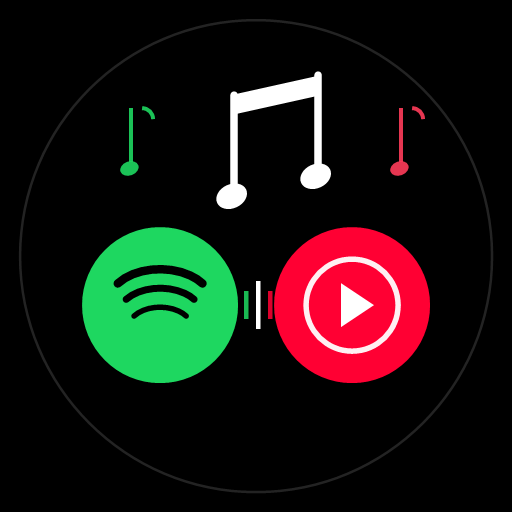

# FrMusic4All

**El reproductor de música definitivo para Android que fusiona lo mejor de Spotify y YouTube Music en una sola experiencia.**

---

## 🎵 ¿Qué es FrMusic4All?

**FrMusic4All** es una aplicación de música para Android diseñada para ofrecer una experiencia auditiva completa, fluida y sin interrupciones. Une la inteligencia de recomendación y las listas personalizadas de **Spotify** con el catálogo gigantesco y la reproducción sin anuncios de **YouTube Music**.

Todo esto sin necesidad de pagar suscripciones Premium de Spotify y con soporte de audio en alta resolución.

---

## ✨ Novedades y Mejoras Clave

### 🖤 Modo AMOLED Puro (#000000)
- **Negro absoluto real:** Diseñado específicamente para pantallas OLED y AMOLED, apagando los píxeles negros en todos los menús, tarjetas, barras de navegación y reproductor.
- **Ahorro máximo de batería:** Disfruta de tus sesiones musicales con el menor consumo de energía posible.

### 📡 Soporte de Cast Ampliado (Google Cast + Amazon Echo)
- **Google Cast:** Reproduce tu música directamente en televisores con Android TV, Chromecast y dispositivos Google Nest.
- **Amazon Echo y Parlantes Inteligentes (DLNA / UPnP):** Ahora puedes castear tu música fácilmente a altavoces Amazon Echo (Alexa), barras de sonido, receptores y cualquier dispositivo compatible con DLNA en tu red Wi-Fi local.

### 🎨 Nueva Identidad Visual
- Nuevo ícono integrado que representa la armonía entre Spotify, YouTube Music y notas musicales sobre un fondo negro profundo.
- Interfaz completamente basada en **Material 3** limpia, moderna e intuitiva.

---

## 🚀 Características Principales

### 🎧 Fusión Spotify + YouTube Music
- **Recomendaciones con tu cuenta de Spotify:** Inicia sesión con tu cuenta gratuita de Spotify directamente en la app (sin configuraciones complejas ni claves de desarrollador) para tener tus canciones favoritas, artistas más escuchados y listas directamente en la pantalla de inicio.
- **Catálogo infinito:** Cada canción se reproduce al instante utilizando los streams de YouTube Music, asegurando disponibilidad incluso de versiones en vivo, remixes y canciones difíciles de encontrar.
- **Opción de audio Lossless (Qobuz):** Soporte experimental para streaming en FLAC de alta resolución (hasta 24-bit / 192 kHz).

### 🎶 Reproductor Avanzado
- **Reproducción en segundo plano:** Escucha tu música con la pantalla apagada o mientras usas otras aplicaciones.
- **Modo sin conexión (Offline):** Descarga tus canciones y listas favoritas o aprovecha la caché automática para reproducirlas sin internet.
- **Letras sincronizadas palabra por palabra (Live Lyrics):** Visualiza letras en tiempo real con efectos visuales animados y estilo karaoke.
- **Listen Together:** Crea una sala y escucha música en tiempo real y sincronizada con tus amigos a distancia.
- **Ecualizador paramétrico y AutoEQ:** Perfiles de ecualización automáticos calibrados para cientos de modelos de auriculares populares (Sony, Bose, Sennheiser, etc.).
- **Salto de silencios y normalización de volumen:** Pasa directamente a la música sin silencios incómodos y con un volumen constante entre pistas.
- **Integraciones:** Compatibilidad con Android Auto, widgets para la pantalla de inicio y Discord Rich Presence.

---

## 📥 Descarga e Instalación

Para instalar la aplicación en tu celular Android de forma rápida:

1. Ve a la sección de [**Releases Oficiales**](https://github.com/russofranco86hot/FrMusic4all/releases/latest).
2. Descarga el archivo instalador **`FrMusic4all.apk`**.
3. Abre el archivo descargado en tu celular.
4. Si tu teléfono lo solicita, permite la opción *"Instalar aplicaciones de fuentes desconocidas"*.
5. ¡Abre **FrMusic4All** y disfruta de tu música!

---

## 🛠️ Tecnologías Utilizadas

- **Lenguaje:** Kotlin
- **Interfaz de Usuario:** Jetpack Compose con Material 3 y MaterialKolor
- **Motor de Audio:** AndroidX Media3 (ExoPlayer) + RemoteCastPlayer
- **Protocolo de Streaming Local:** jUPnP / DLNA para dispositivos Amazon Echo y Smart Speakers
- **Inyección de Dependencias:** Dagger Hilt
- **Base de Datos Local:** Android Room + Proto DataStore

---

## 📄 Créditos y Licencia

FrMusic4All es un proyecto libre y de código abierto desarrollado bajo la licencia **GPL-3.0**, basado originalmente en la base de código de [Metrolist](https://github.com/MetrolistGroup/Metrolist) creado por Mo Agamy.

*Aviso: Este proyecto no está afiliado ni respaldado oficialmente por Spotify AB, Google LLC ni Amazon.com.*
